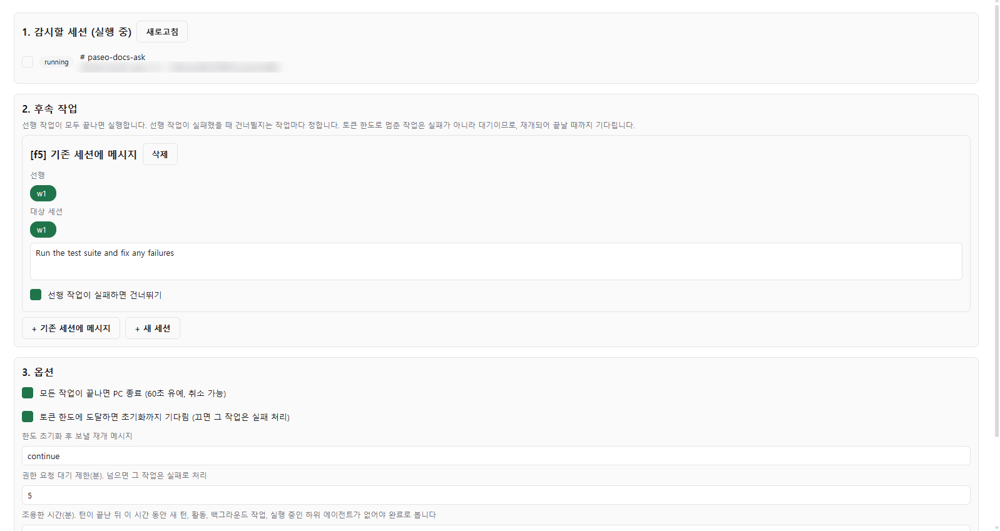

# paseo-session-watch (세션 감시)

[English](README.md)

고른 에이전트 세션이 모두 끝나면 PC를 종료하는 [Paseo](https://paseo.sh) 플러그인. 후속 작업을 의존 관계로 묶을 수 있고, 사용량 한도로 멈춘 세션은 자동 재개한다.



## 설치

```bash
paseo plugin add git:nasus1263/paseo-session-watch
```

데몬에서 플러그인이 켜져 있어야 한다(**Settings → Plugins → Enable plugins**). **Windows** 데몬, Paseo `>=0.15.4`.

## 사용법

1. 사이드바의 **세션 감시** 화면을 연다.
2. 감시할 세션을 고른다.
3. (선택) 후속 작업 추가: 같은 세션에 메시지 보내기, 새 세션 띄우기. 선행 작업이 끝나면 실행된다.
4. 감시를 시작한다.

모든 작업이 끝나면 `shutdown /s /t 60`을 실행한다.

## 주의

- **PC가 종료된다.** 60초 안에 **PC 종료 취소** 또는 `shutdown /a`로 취소할 수 있다.
- 사용량 한도로 멈추면 초기화 시각까지 기다렸다가 `continue`를 보낸다. 초기화 시각을 모르면 30분마다 확인한다.
- 하위 옵션 "감시 대상이 아닌 세션도 포함"을 켜면 계획 밖 세션도 한도로 멈추면 계획에 추가해 재개하고, 그 세션이 스스로 끝날 때까지 완료로 보지 않는다.
- 이 옵션을 켜면 감시할 세션 없이도 시작할 수 있다. 이때는 취소할 때까지 한도로 멈춘 세션 재개만 하고 PC는 끄지 않는다.
- 한도 판정은 Claude 응답 문구("You've hit your limit" 등) 기준이라 문구가 바뀌면 빗나갈 수 있다.
- 오류, 취소, 30분(설정 가능) 넘는 권한 대기는 실패로 끝난다. 실패한 작업에 의존하는 후속 작업은 건너뛴다.
- 계획은 `~/.paseo/plugin-data/paseo-session-watch/plan.json`에 저장되어 재시작 후에도 이어진다. 재시작 직후에는 앱이 연결되거나 에이전트 이벤트가 생겨야 점검이 재개된다.
